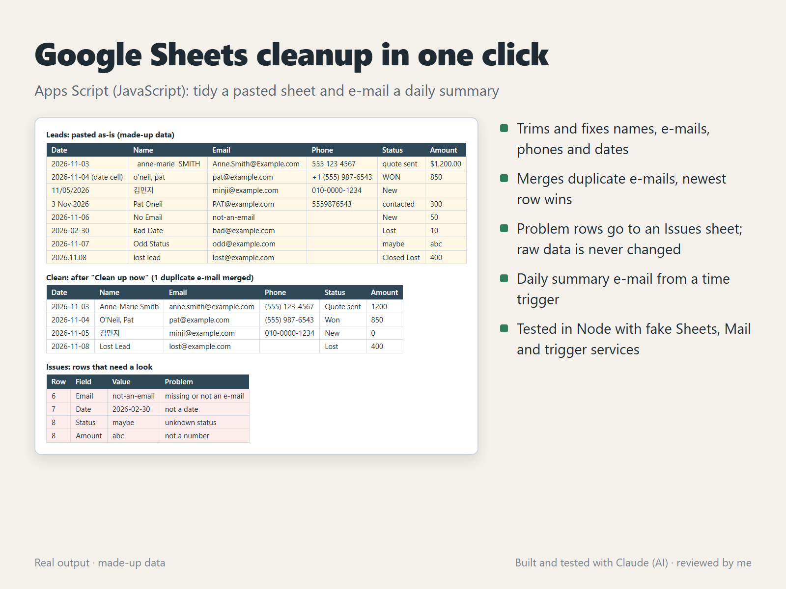

# Google Sheets cleanup in one click (Apps Script / JavaScript)

`Code.js` is a Google Apps Script for a sheet that people paste leads into (or that a form fills). One menu click writes a tidy copy and a list of problems; a time trigger can e-mail a summary every morning.

## What it does

- Adds a **Cleanup** menu with *Clean up now* and *Send summary now*.
- Reads the `Leads` sheet and writes two sheets, rewritten on every run:
  - **Clean:** names in title case (`anne-marie  SMITH` becomes `Anne-Marie Smith`, Korean names stay as they are), lower-case e-mails, phone numbers in one format (US and Korean mobile), dates as `YYYY-MM-DD` from date cells or text such as `11/05/2026`, `3 Nov 2026` or `2026.11.08`, one spelling per status, amounts like `$1,200.00` as numbers.
  - **Issues:** the sheet row, field, value and problem for anything it can't fix (a missing e-mail, `2026-02-30`, an unknown status, `abc` as an amount). Those rows are left out of Clean instead of being guessed.
- Merges rows with the same e-mail and keeps the newest one.
- Never edits the `Leads` sheet.
- Amounts such as `$1,200.00`, `₩120,000` and `1,200원` are read as numbers; anything it can't read with certainty (`12만원`, `abc`) goes to Issues instead of being half-read.
- Every label lives in `CONFIG`: sheet names, column headers, status spellings, issue texts, menu and summary wording. `CONFIG_KO` is a ready Korean set (`문의` / `정리` / `확인 필요` sheets, `신규`, `견적 보냄`, `계약` ...); add `Object.assign(CONFIG, CONFIG_KO);` below it to switch.
- `sendDailySummary` e-mails counts by status, open pipeline and won amount to the address in `CONFIG.summaryTo`. `installDailyTrigger` (run once) schedules it every morning at about 8 and replaces any older trigger for the same function.

## Set it up

1. In the spreadsheet: Extensions > Apps Script, paste `Code.js`, save.
2. Change `CONFIG` at the top if your sheet names or columns differ, and set `summaryTo` if you want the e-mail.
3. Reload the sheet and use Cleanup > Clean up now. Google asks you to authorize the script the first time.
4. Optional: run `installDailyTrigger` once from the editor.

## Tests

`node --test` (Node 18 or newer, no packages). `test.js` checks every cleanup rule, then runs the real entry points against small fakes of `SpreadsheetApp`, `MailApp` and `ScriptApp`:

- the Clean and Issues sheets hold exactly the expected rows, and a second run gives the same result,
- the raw sheet is unchanged,
- the summary e-mail has the right text, and nothing is sent without an address,
- the trigger installer removes only its own old trigger and creates one daily trigger at 8,
- the Korean settings produce Korean statuses, issue texts and summary.

The script was tested this way, in Node; it was not run in a live Google account here. The data in the screenshot is made up and comes from the same test rows.

## How it was made

Built and tested with Claude, an AI agent on my PC. I review the results and handle all messages.
