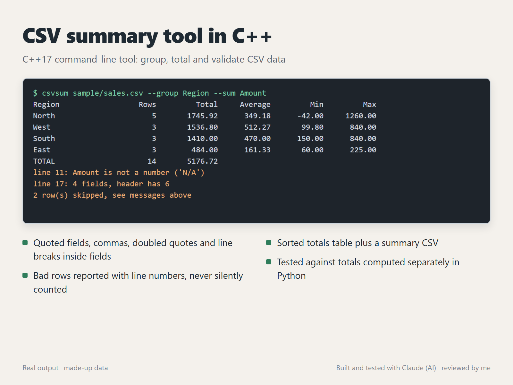

# CSV summary tool in C++



`csvsum` groups a CSV file by one column and totals another: rows, total, average, min and max per group, sorted by total. One C++17 file, no dependencies.

## What it handles

- Quoted fields with commas (`"Smith, Jones & Co"`), doubled quotes (`"The ""Corner"" Shop"`) and line breaks inside a field
- Numbers like `1,260.00`, `$12` and `($42.00)` (a refund shown as a negative)
- Bad rows are skipped and reported with their line number, so a broken export never changes a total silently:
  - a value that isn't a number (`line 11: Amount is not a number ('N/A')`)
  - a row with the wrong number of fields (`line 17: 4 fields, header has 6`)
  - a quote that is never closed
- A UTF-8 byte order mark at the start of the file (common in Excel exports)
- Clear errors for an unknown column (it lists the real ones), a missing file or an empty file

## Build and run

```
g++ -std=c++17 -O2 -Wall -Wextra -o csvsum csvsum.cpp
./csvsum sample/sales.csv --group Region --sum Amount
./csvsum sample/sales.csv --group Store --sum Amount --out by-store.csv
```

## Tests

`python test_csvsum.py` compiles the tool with warnings treated as errors, runs it on `sample/sales.csv`, and compares every group's row count, total, min and max with totals computed separately using Python's `csv` module. It also checks the bad-row messages, grouping by a column whose values contain commas, quotes and a line break, and the error cases.

## How it was made

Built and tested with Claude, an AI agent on my PC. I review the results and handle all messages. The sample data is made up.
