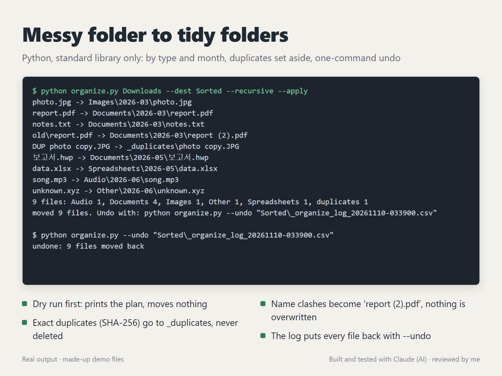

# Messy folder to tidy folders (Python)



`organize.py` sorts a folder such as Downloads into `<type>/<YYYY-MM>/` subfolders. It uses only the Python standard library, never deletes anything and writes a log that puts every file back.

## What it does

- **Dry run by default:** prints where each file would go and a count per folder. Nothing moves until you add `--apply`.
- **Sorting:** by type (`Images`, `Documents`, `Spreadsheets`, `Presentations`, `Archives`, `Audio`, `Video`, `Code`, `Other`), by month of the last change, or both (`--by type|month|type-month`). Korean file names and `.hwp` files work.
- **Duplicates:** files with exactly the same bytes (SHA-256) are spotted. The oldest copy is sorted normally and the others go to `_duplicates`, so you decide what to delete.
- **Name clashes:** if `report.pdf` is already taken, the next one becomes `report (2).pdf`. An existing file is never overwritten.
- **Undo:** `--apply` writes `_organize_log_<time>.csv` (from, to, duplicate). `--undo <log>` moves everything back and removes the folders it created, if they are empty. It refuses to run if one of the original paths has been taken in the meantime.
- Skips hidden files, anything inside hidden folders such as `.git`, and the target folder itself; `--recursive` also takes files from subfolders.
- Each run gets its own log: two runs in the same second write `_organize_log_<time>.csv` and `_organize_log_<time>_2.csv`, never one over the other.

## Run it

```
python organize.py Downloads --dest Sorted                        # dry run
python organize.py Downloads --dest Sorted --recursive --apply    # move the files
python organize.py --undo "Sorted\_organize_log_20261110-033900.csv"
```

## Tests

`python test_organize.py` builds a messy folder in a temp directory (a duplicate photo, two `report.pdf` files, a file name that already exists in the target, a Korean file name, a hidden file, files from different months), then checks that:

- the dry run changes nothing,
- `--apply` puts each file in the expected folder with the expected name and leaves the existing file untouched,
- the log has one row per file, with the duplicate marked,
- `--undo` brings back every file with its original content and removes the empty folders.

The screenshot is a real run on the same kind of made-up files.

## How it was made

Built and tested with Claude, an AI agent on my PC. I review the results and handle all messages.
