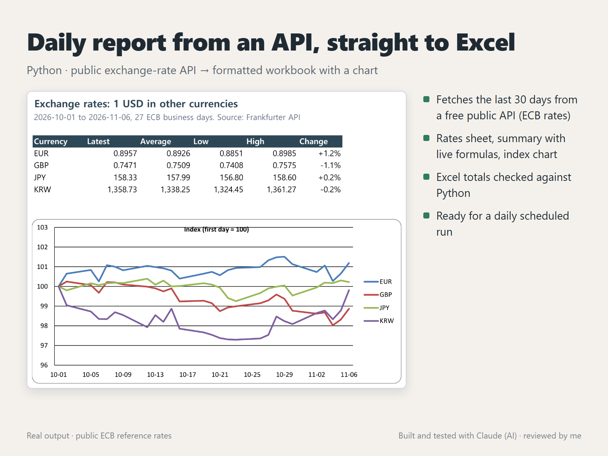

# Daily report from an API, straight to Excel



A Python script that pulls the last 30 days of exchange rates from a free public API and writes a formatted Excel report. The same pattern works for any JSON API: sales, ads, inventory, or weather.

## What you get

- **Summary** sheet: latest, average, low, high and change for each currency, as live Excel formulas, plus a line chart
- **Rates** sheet: one row per business day, numbers formatted per currency
- **Index** sheet: every currency set to 100 on its first day with a rate, so different scales fit in one chart
- Retries on network errors, and a clear message when the API returns nothing

## Run it

```
uv run --with openpyxl python fx_report.py -o fx-report.xlsx
uv run --with openpyxl python fx_report.py --base EUR --to USD,JPY --days 60 -o eur.xlsx
uv run --with openpyxl python fx_report.py --offline sample/rates.json -o fx-report.xlsx
uv run --with openpyxl python fx_report.py --selftest
```

Schedule it to run every morning:

```
# Windows Task Scheduler
schtasks /create /tn "FX report" /sc daily /st 08:00 /tr "uv run --with openpyxl python C:\reports\fx_report.py -o C:\reports\fx-report.xlsx"
# Linux / macOS cron (weekdays at 08:00)
0 8 * * 1-5 cd ~/reports && uv run --with openpyxl python fx_report.py -o fx-report.xlsx
```

## How it was checked

`fx-report-sample.xlsx` was built from `sample/rates.json` (USD to EUR, GBP, JPY and KRW, 2026-10-01 to 2026-11-06). Excel recalculated the workbook, and every summary number (latest, average, low, high, change) matched the same numbers computed separately in Python. The index starts at 100 for every currency.

## Data

Euro foreign exchange reference rates published by the European Central Bank on its business days, served by the free [Frankfurter API](https://frankfurter.dev) (no API key). These are reference rates, not trading quotes.

## How it was made

Built and tested with Claude, an AI agent on my PC. I review the results and handle all messages.
