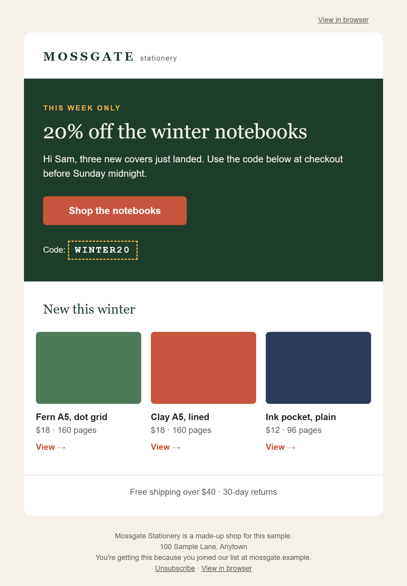
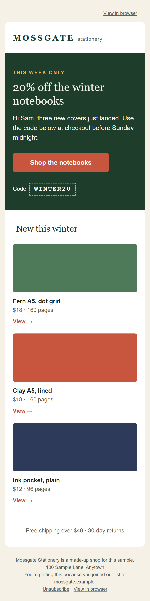

# HTML email template (sample)

<p> </p>

A promo email for a made-up stationery shop, coded by hand the way inboxes need it: tables for layout, inline styles, and a 600 px column that turns into one column on phones. `build.py` checks it and writes copies with the merge tags filled in for Mailchimp, Klaviyo and Brevo.

## Files

- `email.html`: the source, with three placeholders: `%%FIRST_NAME%%`, `%%UNSUBSCRIBE_URL%%` and `%%WEB_VIEW_URL%%`.
- `dist/mailchimp.html`, `dist/klaviyo.html`, `dist/brevo.html`: ready to paste into each platform's code editor.
- `screenshots/`: desktop (680 px), phone (375 px) and [dark mode](screenshots/dark.png), rendered in Chrome.

## Built for real inboxes

- **Layout tables and inline styles.** Gmail and Outlook drop a lot of modern CSS, so every layout table has `role="presentation"` and the styles sit on the elements. The `<style>` block only holds the phone and dark-mode rules.
- **Columns that stack even without media queries.** The three product cards are inline blocks with a max width, so they wrap on narrow screens even in apps that ignore `<style>`. Outlook on Windows gets fixed-width table cells inside conditional comments.
- **A button Outlook can draw.** The call to action is a styled link in most inboxes and a VML rounded rectangle in Outlook on Windows, so it stays a button there too.
- **Preheader.** A hidden first line sets the preview text next to the subject in the inbox list.
- **Nothing breaks with images off.** There are no images: the notebook "covers" are table cells with background colours.
- **Dark mode.** `color-scheme` meta tags and a `prefers-color-scheme` block for Apple Mail and other apps that support it.
- **Links ready for tracking.** Every shop link carries UTM source, medium and campaign.
- **Footer.** Unsubscribe link, postal address and why the reader is getting the email (CAN-SPAM).

## Merge tags

| Placeholder | Mailchimp | Klaviyo | Brevo |
|---|---|---|---|
| `%%FIRST_NAME%%` | `*\|FNAME\|*` (fallback set in the audience settings) | `{{ first_name\|default:'there' }}` | `{{ contact.FIRSTNAME\|default:"there" }}` |
| `%%UNSUBSCRIBE_URL%%` | `*\|UNSUB\|*` | `` | `{{ unsubscribe }}` |
| `%%WEB_VIEW_URL%%` | `*\|ARCHIVE\|*` | `` | `{{ mirror }}` |

Tag names come from each platform's docs. On a client project, a test send from the client's account checks them before anything goes out.

## Check it

```
python build.py   # checks the HTML, then writes dist/ and screenshots/ (screenshots need Chrome)
```

The build fails if the file nears Gmail's clipping limit (about 102 KB), a link goes nowhere, a layout table lacks `role="presentation"`, an image has no alt text, a placeholder is unknown, or the footer loses its unsubscribe link or address.

The screenshots come from Chrome only. Gmail, Outlook and Apple Mail are checked with test sends on client projects; this sample hasn't been through them.

## How it was made

Built and checked with Claude, an AI agent on my PC. The shop, products and address are made up, and the links use the reserved `.example` domain.
