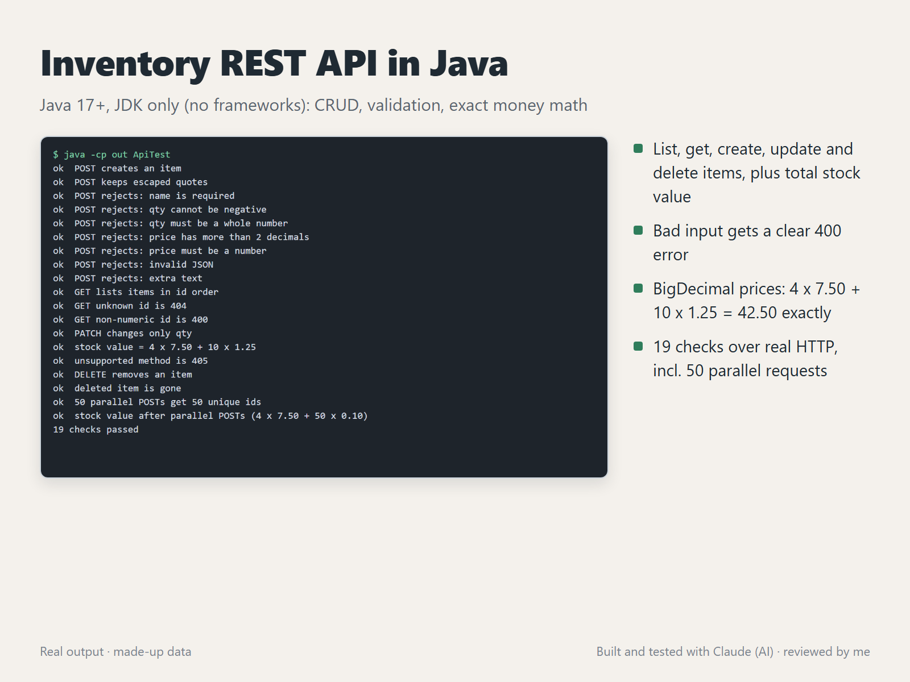

# Inventory REST API in Java



A small inventory API built with the JDK alone (no frameworks, no dependencies), with tests that run it over real HTTP.

## Endpoints

| Method | Path | What it does |
|---|---|---|
| GET | `/api/items` | List items in id order |
| GET | `/api/items/{id}` | One item, or 404 |
| POST | `/api/items` | Create `{"name":"Mug","qty":3,"price":7.50}` and return 201 |
| PATCH | `/api/items/{id}` | Change any of name, qty or price |
| DELETE | `/api/items/{id}` | Remove an item and return 204 |
| GET | `/api/stock-value` | `{"items":2,"total":42.50}`, the sum of qty x price |

## Details

- **Validation:** a missing name, negative or fractional qty, negative price, more than 2 decimals, a wrong type, broken JSON or extra text all return `400` with a clear `{"error": ...}` message.
- **Money:** prices are `BigDecimal`, so totals are exact (no `0.1 + 0.2` errors).
- **Concurrency:** items live in a `ConcurrentHashMap` with an `AtomicLong` id, and the server runs on a thread pool.
- **JSON:** a small parser for flat objects that handles escaped quotes and `\u` escapes. No library needed.

## Run and test

```
javac -Xlint:all -Werror -d out src/InventoryApi.java src/ApiTest.java
java -cp out InventoryApi 8080      # http://127.0.0.1:8080/api/items
java -cp out ApiTest                # starts the API on a free port and runs 19 checks
```

The tests cover every endpoint, each validation error, 404 and 405 responses, exact stock-value totals, and 50 parallel POST requests that must each get a unique id.

## How it was made

Built and tested with Claude, an AI agent on my PC. I review the results and handle all messages.
