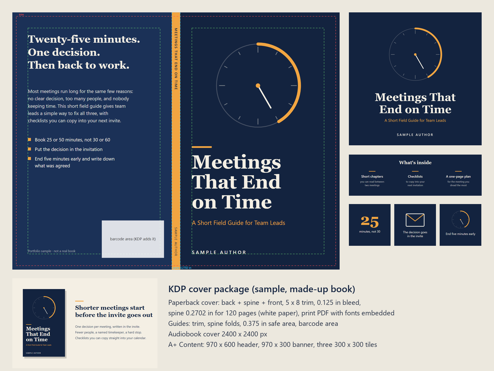

# KDP cover package (sample)

A cover package for a made-up book, *Meetings That End on Time*: the full paperback cover for Amazon KDP, a square audiobook cover and five Amazon A+ Content images. Everything is drawn in code (SVG rendered by headless Chrome), so there are no stock photos to license. "Sample Author" is a placeholder and the book doesn't exist.



## Files

| File | What it is |
|---|---|
| [out/cover-print.pdf](out/cover-print.pdf) | Print-ready full cover: back + spine + front in one PDF, 10.5202 × 8.25 in, fonts embedded |
| [out/cover-guides.png](out/cover-guides.png) | The same cover with trim lines, spine folds, safe area and the barcode area drawn on top (for checking, not for upload) |
| [out/audiobook-2400.png](out/audiobook-2400.png) | Audiobook cover, 2400 × 2400 px |
| [out/aplus-header-970x600.png](out/aplus-header-970x600.png) | A+ "image header with text" module, 970 × 600 |
| [out/aplus-banner-970x300.png](out/aplus-banner-970x300.png) | A+ banner, 970 × 300 |
| out/aplus-tile-1..3-300x300.png | A+ "three images and text" module, three 300 × 300 images |

## The KDP numbers it uses

- Trim 5 × 8 in, 120 pages on white paper.
- Spine width = pages × 0.002252 in = 0.2702 in (cream paper is 0.0025 in per page).
- Full cover width = 0.125 bleed + 5 back + 0.2702 spine + 5 front + 0.125 bleed = 10.5202 in; height = 8 + 2 × 0.125 = 8.25 in.
- Text stays at least 0.375 in inside the trim (KDP's minimum is 0.125 in).
- The lower right of the back cover (2 × 1.2 in, 0.25 in from the trim) is kept clear for the barcode KDP adds.
- Spine text is only allowed above 79 pages. For a thinner book the spine becomes a plain colour band, which is why the spine here is its own element.

Chrome rounds PDF page sizes by up to half a point, so the build places Chrome's page on an exact 757.457 × 594 pt page before saving.

## Build and checks

```
pip install pymupdf pillow
python build.py
```

`build.py` writes every file in `out/`, then checks that the PDF is one page of exactly the calculated size, that every font is embedded, that author, creator and producer are empty, and that each PNG has the exact pixel size Amazon asks for.

The fonts are Georgia and Segoe UI from Windows, which is fine for a portfolio piece. For a real book I'd use the author's licensed fonts or ones licensed for commercial print.
