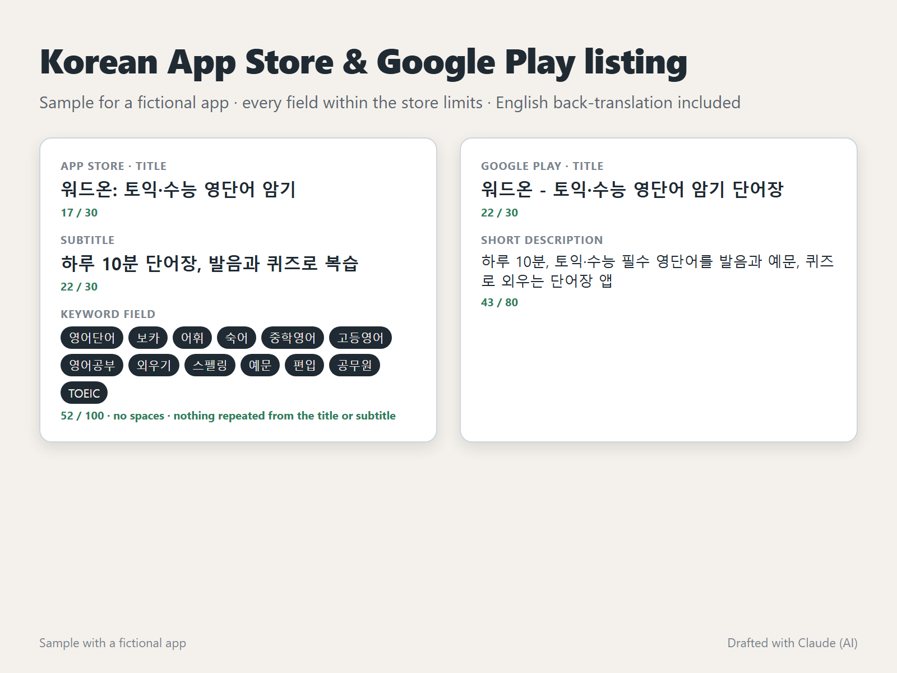

# Korean App Store & Google Play listing (sample)



A sample Korean store listing for a fictional vocabulary app, **WordOn (워드온)**. It shows what a client gets: every field within the store's character limit, keywords that don't waste space, and an English back-translation of every line.

## App Store

| Field | Korean | Characters | English back-translation |
|---|---|---|---|
| Title | 워드온: 토익·수능 영단어 암기 | 17 / 30 | WordOn: TOEIC & SAT-style English vocabulary memorizing |
| Subtitle | 하루 10분 단어장, 발음과 퀴즈로 복습 | 22 / 30 | 10-minute daily word book, review with pronunciation and quizzes |
| Keywords | 영어단어,보카,어휘,숙어,중학영어,고등영어,영어공부,외우기,스펠링,예문,편입,공무원,TOEIC | 52 / 100 | English words, voca, vocabulary, idioms, middle-school English, high-school English, English study, memorize, spelling, example sentences, transfer exam, civil-service exam, TOEIC |

## Google Play

| Field | Korean | Characters | English back-translation |
|---|---|---|---|
| Title | 워드온 - 토익·수능 영단어 암기 단어장 | 22 / 30 | WordOn - TOEIC & SAT-style vocabulary word book |
| Short description | 하루 10분, 토익·수능 필수 영단어를 발음과 예문, 퀴즈로 외우는 단어장 앱 | 43 / 80 | 10 minutes a day: learn must-know TOEIC and SAT-style words with pronunciation, example sentences and quizzes |

## Why it's written this way

- **No wasted keywords:** the App Store matches search words from the title, subtitle and keyword field together, so the keyword field doesn't repeat words already in the title or subtitle. `build.py` fails if one slips in. It caught `단어장` (word book), which is already in the subtitle.
- **No spaces in the keyword field:** commas only, so every character counts.
- **Exams Koreans actually study for:** 토익 (TOEIC), 수능 (the national university entrance exam), 편입 (transfer exam) and 공무원 (civil-service exam) name the reasons people learn vocabulary in Korea.
- **Natural Korean, not a word-for-word translation:** the subtitle and short description read like a Korean app, and the back-translation shows the client exactly what they say.

In a real project, keywords are checked against the Korean store search suggestions and the titles of competing apps before they're chosen. This sample uses a fictional app, so it shows the format and the checks, not market data.

## Check it

```
python build.py   # checks every limit, spaces and repeats, then renders the cover
```

## How it was made

Drafted with Claude, an AI agent on my PC. In client work, I read every Korean line as a native speaker before delivery.
