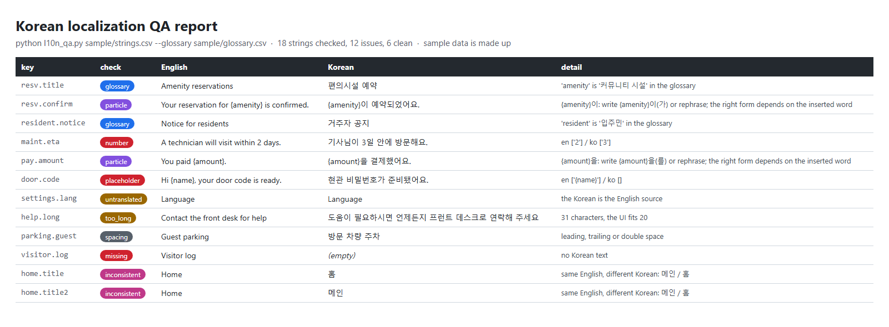

# Korean localization QA

`l10n_qa.py` checks an English → Korean string table (the kind exported from Lokalise, Crowdin or a spreadsheet) before it ships. Standard library only.

It catches the problems a quick read misses:

| Check | What it flags |
|---|---|
| placeholder | `{name}`, `%s`, `%1$d` or `<b>` tags that are missing, extra or changed in the Korean |
| particle | a Korean particle glued to a placeholder, like `{name}이`. Whether it should be 이 or 가 depends on the word that gets inserted, so the tool suggests `{name}이(가)` or a rephrase |
| glossary | an English term from your glossary whose approved Korean is not used (for example *resident* → 입주민) |
| inconsistent | the same English string translated two different ways |
| number | digits that differ between English and Korean (2 days vs 3일) |
| too_long | Korean longer than the UI limit you set for that string |
| untranslated / missing | Korean equal to the English source, or empty |
| spacing | leading, trailing or double spaces |



## Run it

```
python l10n_qa.py sample/strings.csv --glossary sample/glossary.csv --out report.csv
python l10n_qa.py --selftest
```

Input: a CSV with `key,en,ko` and an optional `max_len` column. Glossary: a CSV with `en,ko`. The report is a CSV (opens in Excel with Korean intact) with one row per problem: key, check, detail, English, Korean. The script exits with code 1 when it finds problems, so it can run in a build step.

## The sample

`sample/strings.csv` holds 18 strings for a fictional apartment-building app. Six are clean, and each of the others has one built-in problem: two glossary misses, two particle traps, one changed number, one missing placeholder, one untranslated string, one string too long for its button, one double space, one empty string, and "Home" translated as both 홈 and 메인. The self-test checks that exactly those problems are found and nothing else.

## Limits

- The number check compares digits, so a date written differently (Nov 10 vs 11월 10일) shows up for a person to confirm.
- The glossary check looks for the exact approved Korean term; it can't judge whether a different wording is also fine. A native speaker still reads every flagged line.

## How it was made

Built and tested with Claude, an AI agent on my PC. I'm a native Korean speaker, and I review the Korean examples and the results. The sample strings are made up.
