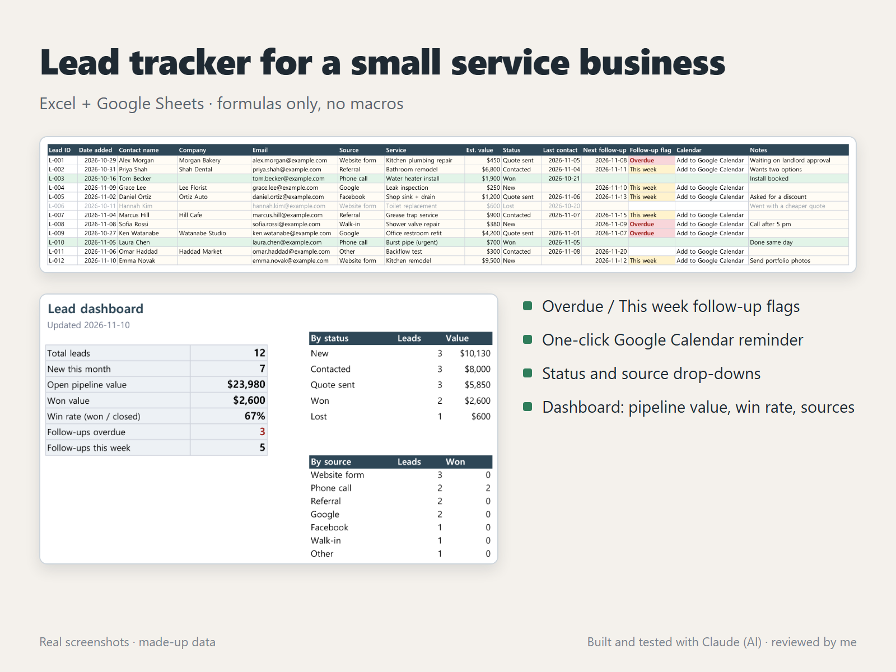

# Lead tracker for a small service business (Excel + Google Sheets)

A simple tracker for enquiries, follow-ups and quotes. It's built with formulas only (no macros), so it opens in Excel and Google Sheets.

## What it does

- **Leads tab**: one row per enquiry. Lead ID, follow-up flag and calendar link fill in by themselves.
- **Follow-up flags**: `Overdue` (red) when the next follow-up date has passed, `This week` (yellow) when it's within 7 days. Won and Lost leads aren't flagged.
- **Google Calendar link**: one click opens a ready-made all-day reminder for that follow-up date. It's built with `SUBSTITUTE` instead of `ENCODEURL`, so it also works in Excel for Mac and the web.
- **Drop-downs** for Status and Source (edit the choices on the Lists tab), plus date checks.
- **Dashboard tab**: total leads, new this month, open pipeline value, won value, win rate, overdue follow-ups, and counts by status and by source.

## Files

| File | What it is |
|---|---|
| `lead-tracker.xlsx` | Empty template (500 rows) |
| `lead-tracker-sample.xlsx` | Same template with 12 made-up leads (emails use example.com) |
| `build.py` | Builds both files with openpyxl |
| `check.py` | After Excel recalculates the files, compares the dashboard with values computed separately in Python |

## How it was checked

1. `build.py` builds the files and writes the expected dashboard numbers to `expected.json`, calculated in Python without the spreadsheet formulas.
2. Excel opens both files, recalculates everything and saves.
3. `check.py` confirms that there are no error cells and that every dashboard number matches (12 leads, $23,980 open pipeline, 67% win rate, 3 overdue, 5 due this week on the build date).
4. The sample was also opened in Google Sheets. Every dashboard number and both breakdown tables came out the same.
5. File metadata is cleaned before publishing (no author name, file paths or printer settings).

The flags use `TODAY()`, so the sample's flags change as days pass. That's how the tracker works in real use. In Google Sheets, `TODAY()` follows the spreadsheet's time zone (File > Settings), so set it to your own time zone. Otherwise a follow-up due "today" can show up a day early or late.

## How it was made

Built and tested with Claude, an AI agent on my PC. I review the results and handle all messages. The sample data is made up.
