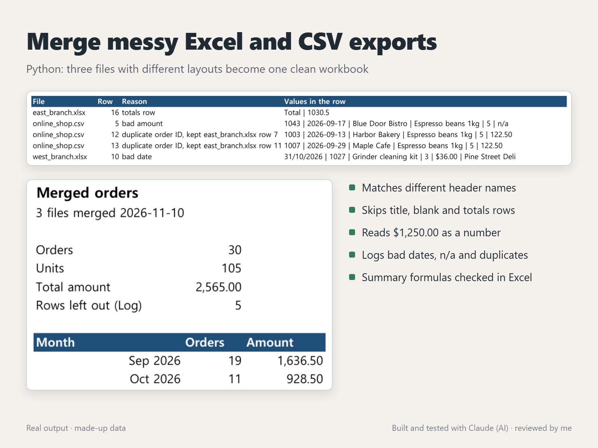
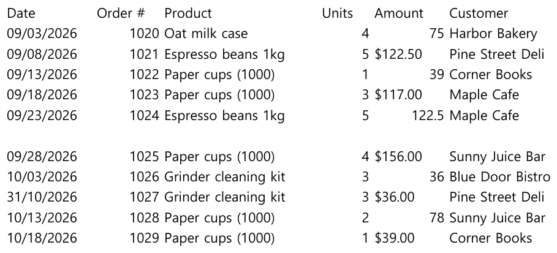

# Merge messy Excel and CSV exports (Python)



`merge_files.py` reads every `.xlsx` and `.csv` file in a folder, finds the header row in each one, maps the different column names to one layout and writes a single workbook: all orders on one sheet, a Summary with live formulas, and a Log of every row it left out and why. It is the usual "each branch sends a file every month and someone copies them together by hand" job.

## What it does

- Finds the header row even under a title line, and matches different names for the same column (`Client`, `Customer`, `customer_name`; `Total ($)`, `Amount`, `amount_usd` ...). The names live in one dictionary at the top of the script.
- Skips blank rows and the totals row at the bottom of an export
- Reads dates as real dates (`2026-09-01`, `09/03/2026` from US exports, `5 Mar 2026`) and amounts as numbers (`$1,250.00`, `USD 30`, `(12.50)` for a refund)
- Never guesses: a date that can't be right (`31/10/2026` in a month-first file), an amount like `n/a`, or an order ID already seen in another file goes to the **Log** sheet with the file name and row number
- **Orders** sheet sorted by date, with the source file of every row, a frozen header and filters
- **Summary** sheet: orders, units and total, by month and by file, as `COUNTIFS` / `SUMIFS` formulas that keep working when you edit the Orders sheet

## Run it

```
uv run --with openpyxl python merge_files.py sample/input -o merged.xlsx
uv run --with openpyxl python merge_files.py --make-samples my_samples
uv run --with openpyxl python merge_files.py --selftest
uv run --with openpyxl python merge_files.py --check sample/merged.xlsx
```

## The example

`sample/input/` holds three made-up exports with the problems real ones have:



- `east_branch.xlsx`: a title line above the header, `Client` / `Item` / `Total ($)` as column names, a totals row at the bottom
- `west_branch.xlsx` (above): columns in another order, dates as US text, half of the amounts as text with `$`, a blank row and one day-first date
- `online_shop.csv`: `snake_case` headers, one `n/a` amount and two orders that were already in the east file

The result, `sample/merged.xlsx`, has 30 orders and 5 rows in the Log: the totals row, the `n/a` amount, the two duplicates and the impossible date.

## How it was checked

- `--selftest` builds the three example files in a temporary folder, merges them and checks the order count, every Log reason and row number, the date order, the total against a sum taken straight from the generated data, and the formulas in the written workbook. It also tests the date, amount and quantity readers on edge cases.
- `sample/merged.xlsx` was recalculated in Excel, and `--check` compared every Summary value with numbers computed separately in Python from the Orders sheet. All matched.

## Adapting it

Add your column names to `ALIASES`, and change `NEEDED` if other columns are required. Duplicates are matched on the order ID and the first file (in name order) wins; if a later export can correct an earlier row, the rule can change to "newest file wins".

## Files

| File | What it is |
|---|---|
| `merge_files.py` | The merger, workbook writer, example maker, self-test and check |
| `sample/input/` | The three made-up exports |
| `sample/merged.xlsx` | The merged workbook, recalculated in Excel |

## How it was made

Built and tested with Claude, an AI agent on my PC. I review the results and handle all messages.
