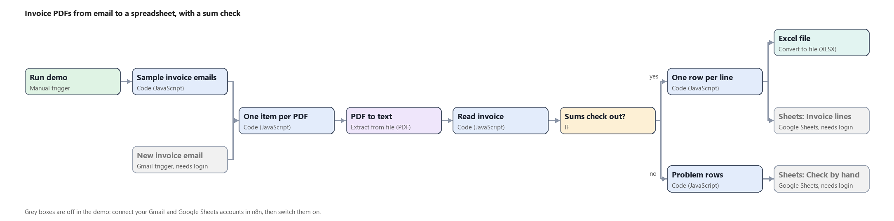

# n8n invoice PDFs: email attachments to a spreadsheet, with a sum check

An n8n workflow for the supplier invoices that land in a mailbox. Every PDF attachment is read, the invoice number, date, vendor and lines are pulled out, and the arithmetic is checked before anything is written. Invoices that add up become one row per line in an Excel file (or a Google Sheet). An invoice that doesn't add up goes to a "Check by hand" tab with the reason, instead of slipping into the books.

## What each step does

| Step | Node | What happens |
|---|---|---|
| 1 | New invoice email / Run demo | Gmail picks up mails with a PDF attached. For the demo, two made-up mails carry three invoice PDFs |
| 2 | One item per PDF | A mail can have several attachments: each PDF becomes its own item, and other files are skipped |
| 3 | PDF to text | n8n's Extract from File node reads the text out of the PDF |
| 4 | Read invoice | Finds the invoice number, date, vendor, the lines (description, qty, unit price, amount), subtotal, tax and total |
| 5 | Sums check out? | Each line is qty × unit price, the lines add up to the subtotal, and subtotal + tax is the total. All in whole cents, so 0.1 + 0.2 rounding can't cause a false alarm |
| 6 | One row per line → Excel file | One row per invoice line, with the invoice details on every row so the sheet sorts and filters well. Saved as `invoices.xlsx` (sheet "Invoice lines") |
| 7 | Sheets: Invoice lines | The same rows appended to a Google Sheet |
| 8 | Problem rows → Sheets: Check by hand | Invoices that failed a check, one row each, with the reason |

## Demo run

`n8n execute` on the three sample invoices gives this sheet:

| Invoice no | Date | Vendor | Line | Description | Qty | Unit price | Amount | Invoice total |
|---|---|---|---|---|---|---|---|---|
| INV-1041 | 2026-11-03 | Northwind Office Supply | 1 | A4 copy paper, box of 5 reams | 4 | 28.50 | 114.00 | 308.77 |
| INV-1041 | 2026-11-03 | Northwind Office Supply | 2 | Black toner cartridge | 2 | 64.00 | 128.00 | 308.77 |
| INV-1041 | 2026-11-03 | Northwind Office Supply | 3 | Desk organiser | 3 | 12.90 | 38.70 | 308.77 |
| HP-2207 | 2026-11-10 | Harbor Print Co. | 1 | Business cards, 500 pcs | 2 | 45.00 | 90.00 | 226.80 |
| HP-2207 | 2026-11-10 | Harbor Print Co. | 2 | A5 flyers, 1,000 pcs | 1 | 120.00 | 120.00 | 226.80 |

Sent to "Check by hand": PC-3315 from Peak Cloud Hosting, "lines add up to 82.00 but the subtotal says 92.00". That invoice has a wrong subtotal on purpose, the kind of mistake that costs money if nobody looks.

## Use it

1. Import `workflow.json` in the n8n editor (Import from File), or run `n8n import:workflow --input=workflow.json`.
2. Run it from the editor. Run demo is a manual trigger with the sample PDFs built in, so you see the run above without connecting anything. The Excel file node's output has a download button.
3. To go live, connect your Gmail and Google Sheets accounts in n8n, pick the sheet, switch the three grey nodes on, delete Run demo and Sample invoice emails, and turn the workflow on. Narrow the Gmail search (`has:attachment filename:pdf`) to your suppliers if the mailbox gets other PDFs.
4. Read invoice is written for the layout of the sample invoices. Each supplier lays out its PDF a little differently, so a real setup gets one small pattern per supplier, or an AI step for the odd ones (see [claude-invoice-to-excel](../claude-invoice-to-excel)). Scanned PDFs have no text to read and need OCR first.

n8n 2.x only lets the Read/Write Files from Disk node touch `~/.n8n-files` unless `N8N_RESTRICT_FILE_ACCESS_TO` says otherwise. That is why the demo carries its PDFs inside the workflow instead of reading a folder.

## Files

- `workflow.json`: the workflow (n8n 2.x, built and tested on 2.49.6)
- `build.py`: writes the three sample PDFs in `samples/` and `workflow.json` with the PDFs inside it
- `selftest.py`: imports and runs the workflow with the n8n command line in a throwaway n8n folder, then checks the invoices read, the totals, the rows and the "Check by hand" reason
- `make_diagram.py`, `diagram.png`: the picture above, drawn from `workflow.json`

## How it was made

Built and tested with Claude, an AI agent on my PC. I reviewed the results. The invoices, companies and mail addresses are made up and use reserved `.example` domains.
