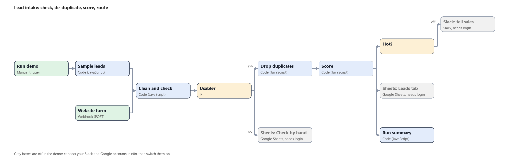

# n8n lead intake: check, de-duplicate, score, route

An n8n workflow for website enquiries. Each lead is cleaned and checked, repeats are dropped, and a plain-rule score decides who gets a Slack ping. Scored leads go to a Google Sheet, and leads that can't be used go to their own "Check by hand" tab instead of disappearing.



## What each step does

| Step | Node | What happens |
|---|---|---|
| 1 | Website form / Run demo | Leads arrive as a form POST (webhook) or, for the demo, as 8 made-up sample leads |
| 2 | Clean and check | Trims names, lowercases emails, keeps only digits in phone numbers, and writes down why a lead can't be used ("no email or phone", "email looks wrong") |
| 3 | Usable? | Usable leads go on; the rest go to the "Check by hand" tab |
| 4 | Drop duplicates | The same email (or phone) twice in one batch: the first one stays |
| 5 | Score | Budget mentioned +40, budget of $1,000 or more +20, wants it soon +25 ("not urgent" and "no rush" don't count), detailed request +15. 60+ is hot, 30–59 warm, the rest cold |
| 6 | Hot? → Slack | Hot leads are posted to #sales with the reasons |
| 7 | Sheets: Leads tab | Every scored lead with its score, tier and reasons |
| 8 | Run summary | Counts per tier for the log and the self-test |

## Demo run

`n8n execute` on the 8 sample leads gives:

```
hot   80  Jane Cooper <jane.cooper@example.com>  budget $800, wants it soon, detailed request
warm  40  Ravi Patel <ravi@acme-logistics.example>  wants it soon, detailed request
cold  15  Maria Gomez <maria.gomez@example.net>  detailed request
cold   0  Tom Becker <tom.becker@example.org>  no signals
hot   75  Chen Wei <chen.wei@brightwave.example>  budget $2,000, budget 1,000+, detailed request
```

Sent to "Check by hand": Lee (no email or phone) and Aisha Khan (email looks wrong). Dropped as a repeat: Jane Cooper's second form.

## Use it

1. Import `workflow.json` in the n8n editor (Import from File), or run `n8n import:workflow --input=workflow.json`.
2. Run it from the editor. Run demo is a manual trigger, so you see the sample run above without connecting anything.
3. To go live, connect your Slack and Google Sheets accounts in n8n, pick the sheet and the channel, switch the three grey nodes on, delete Run demo and Sample leads, and turn the workflow on. Your form then posts `name`, `email`, `phone`, `source` and `message` as JSON to the webhook's production URL (path `lead-intake`).
4. Change the rules in the Score node. They are a few lines of commented JavaScript.

This demo only compares leads within one run. For a live form, look up the email in the sheet before adding a row (Google Sheets "Get rows"), or use n8n's Remove Duplicates node with "Remove items processed in previous executions".

## Files

- `workflow.json`: the workflow (n8n 2.x, built and tested on 2.49.6)
- `selftest.py`: imports and runs the workflow with the n8n command line, then checks the counts, the reject reasons and the "not urgent" trap
- `make_diagram.py`, `diagram.png`: the picture above, drawn from `workflow.json`

## How it was made

Built and tested with Claude, an AI agent on my PC. I reviewed the results. The leads are made up and use reserved `.example` domains.
