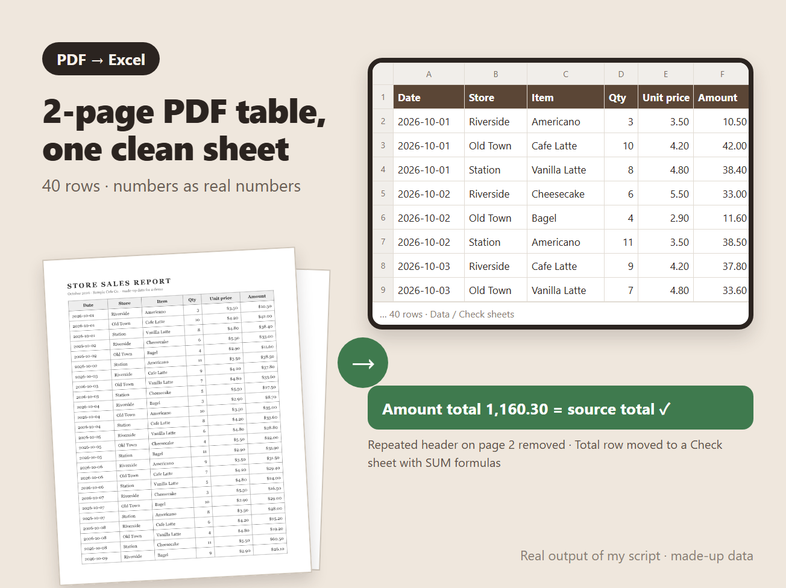

# PDF tables to one clean Excel sheet



Turns tables from PDFs (and from scans or photos typed into a CSV) into one Excel sheet that you can sort, filter and sum, then checks the totals against the source.

## What it does

- Joins a table that runs across pages into one sheet and drops the header row repeated on later pages
- Stores numbers as real numbers: `1,234.50`, `$12`, `(3.00)` and `12%` become numbers, while dates and codes with leading zeros stay as text
- Formats numbers per column, so a money column doesn't mix `42` with `38.40`
- Moves the source's `Total` row to a **Check** sheet, where `SUM` formulas are compared with the source totals (OK / CHECK)
- Marks unreadable cells from scans (`[?]` in the CSV) as blank yellow cells and lists them on a **Notes** sheet, so nothing is guessed

## Sample (made-up data)

`sample/sample_sales_report.pdf` is a 2-page, 40-row sales report. `sample/sample_sales_report.xlsx` is the result:

```
40 rows -> sample_sales_report.xlsx
  Qty: sum 279.00 / source 279.00 OK
  Unit price: sum 167.20
  Amount: sum 1,160.30 / source 1,160.30 OK
```

## Run it

```
uv run --with openpyxl --with pymupdf python pdf2xlsx.py report.pdf -o report.xlsx
uv run --with openpyxl --with pymupdf python pdf2xlsx.py --selftest
```

The self-test draws a 2-page table PDF, converts it, and checks the row count, the totals, the number formats, and a CSV with an unreadable cell.

## Notes

- Text PDFs (exported from software) are read with PyMuPDF. Each cell's text is read with MuPDF's own text extraction, because the table extractor's text misplaced decimal points in testing (`1.50` became `150 .`).
- Scans and photos are read with AI-assisted extraction into a CSV first, then checked row by row against the source.
- Built and tested with Claude, an AI agent on my PC. I review the results and handle all messages.
