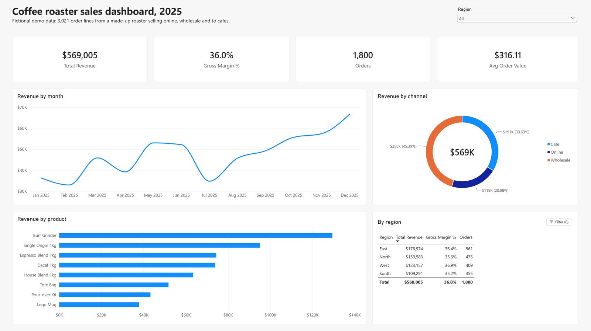
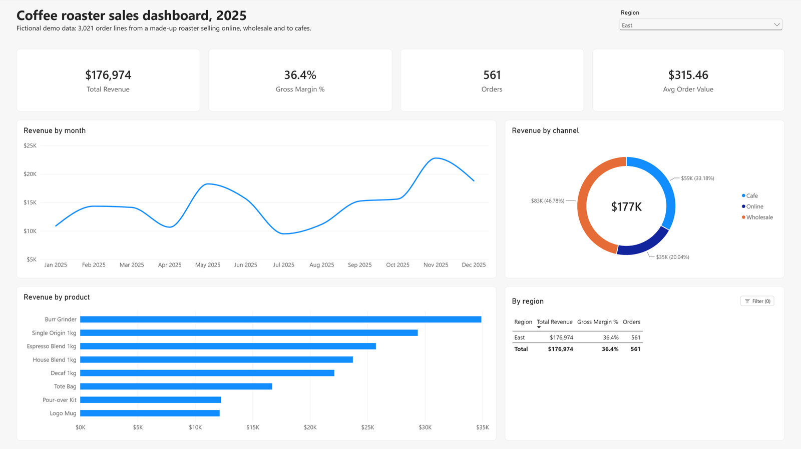

# Power BI sales dashboard: a coffee roaster's year on one page

A one-page Power BI report for a made-up coffee roaster that sells online, wholesale and to cafes. It has four KPI cards, revenue by month, channel and product, a region table, and a Region filter that drives every visual. The report is saved as a Power BI Project (PBIP): the data model is plain text (TMDL) and each visual is a small JSON file, so a change shows up in git like code.



The same page with East picked in the Region filter:



## What's inside

| Part | What it does |
|---|---|
| Data | `data/sales.csv`: 3,021 order lines (1,800 orders) for 2025, made up by `make_data.py` with a seasonal curve (busy November and December), 4 regions, 3 channels and 8 products |
| Power Query | Reads the CSV from the `DataFile` parameter, sets the column types, and adds a `MonthLabel` column ("Jan 2025") sorted by the month date, so the axis reads the same on any PC's regional settings |
| Measures (DAX) | `Total Revenue = SUM(sales[Revenue])`<br>`Gross Margin % = DIVIDE([Total Revenue] - SUM(sales[Cost]), [Total Revenue])`<br>`Orders = DISTINCTCOUNT(sales[OrderID])` (an order can have several lines)<br>`Avg Order Value = DIVIDE([Total Revenue], [Orders])` |
| Report | One 1920 × 1080 page: title, Region dropdown, 4 cards, line chart, donut chart, bar chart sorted by revenue, and a table with totals |
| Model settings | Auto date/time is off, so there are no hidden date tables. Unit price and unit cost don't add up when dropped into a visual |

## Check

`check_model.ps1` connects to the model that Power BI Desktop has open and asks it for the totals, the revenue by region, channel and category, and the revenue for each month. It compares the answers with `data/expected.json`, which `make_data.py` works out in Python from the same CSV:

```
27 of 27 checks match data/expected.json
```

With two expected values changed on purpose, it lists both (`FAIL Orders  model=1800  expected=1799`, and the same for East) and exits with an error.

## Open it

1. Install Power BI Desktop (free, Windows).
2. Open `SalesDemo.pbip`. The data cache isn't in git, so the visuals start empty.
3. Transform data > Edit parameters: set `DataFile` to the full path of `data\sales.csv` on your PC, then Refresh.
4. Optional: with the report open, run `powershell -ExecutionPolicy Bypass -File check_model.ps1`.

For real data, point `DataFile` at a CSV with the same columns, or change the first Power Query step to read Excel, SharePoint or a database.

## Files

- `SalesDemo.pbip`, `SalesDemo.Report/`, `SalesDemo.SemanticModel/`: the Power BI Project (Power BI Desktop 2.160, November 2026)
- `make_data.py`: writes the fictional `data/sales.csv` and the expected numbers in `data/expected.json`
- `build_pbip.py`: writes the table, measures and report page into the project
- `check_model.ps1`: the check above
- `screenshot.png`, `screenshot-east.png`: Power BI Desktop screenshots of the report

## How it was made

Built with Claude, an AI agent on my PC. Power BI Desktop loaded the CSV once and saved an empty project, `build_pbip.py` wrote the model and the visuals, and Desktop refreshed and saved the result. I reviewed the results. The company, products and numbers are made up.
