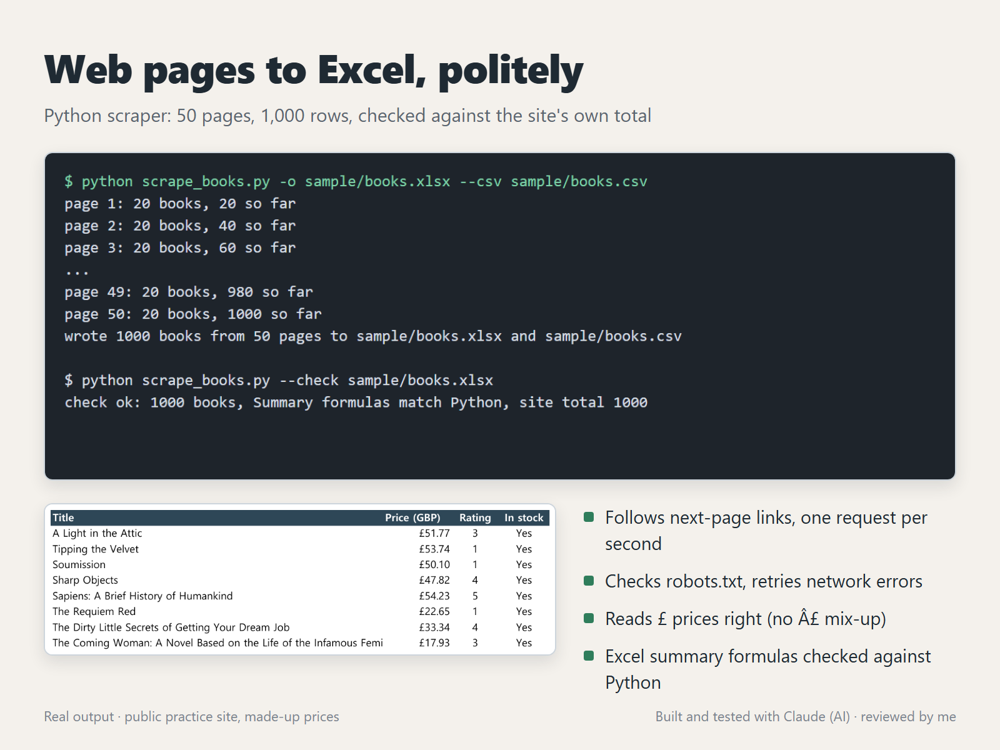

# Web pages to Excel, politely (Python scraper)



`scrape_books.py` walks every listing page of [books.toscrape.com](https://books.toscrape.com), a public sandbox made for scraping practice, and writes the results to a CSV file and a formatted Excel workbook. The same structure fits most "copy this catalogue into a spreadsheet" jobs: change the selectors in `parse()` and the columns.

## What it does

- Follows the "next" link until the last page (or `--max-pages`), and skips books it has already seen
- Waits `--delay` seconds between requests (default 1) and sends its own User-Agent
- Reads `robots.txt` first and stops if the start page is not allowed
- Retries network errors and 5xx responses with a growing pause; a 4xx stops the run with a clear error
- Sets the page encoding to UTF-8: the site sends no charset, so a plain `requests` call guesses Latin-1 and turns `£51.77` into `£51.77`
- **Books** sheet: title, price, rating (1–5), in stock, link, with a frozen header and filters
- **Summary** sheet: counts, average / cheapest / most expensive price and a table by rating, as live Excel formulas, plus the total the site itself reports
- CSV with a byte order mark, so Excel opens it with the `£` intact

## Run it

```
uv run --with requests --with beautifulsoup4 --with openpyxl python scrape_books.py -o books.xlsx --csv books.csv
uv run --with requests --with beautifulsoup4 --with openpyxl python scrape_books.py --max-pages 2 -o quick.xlsx
uv run --with requests --with beautifulsoup4 --with openpyxl python scrape_books.py --selftest
uv run --with requests --with beautifulsoup4 --with openpyxl python scrape_books.py --check sample/books.xlsx
```

## How it was checked

- `--selftest` parses a saved snippet of the page (including a price already mangled to `£53.74`), checks every field, the next-page link and the site total, then writes and re-reads a workbook and a CSV.
- The full run collected 1,000 books from 50 pages, the same number the site reports on its first page.
- `sample/books.xlsx` was recalculated in Excel, and `--check` compared every Summary value with numbers computed separately in Python from the Books sheet. All matched.

## Files

| File | What it is |
|---|---|
| `scrape_books.py` | The scraper, workbook writer, self-test and check |
| `sample/books.xlsx` | Output of a full run (1,000 rows), recalculated in Excel |
| `sample/books.csv` | The same rows as CSV |

## Before you point it at another site

Scrape only sites whose terms and `robots.txt` allow it, keep the delay, and don't collect personal data. The prices and ratings on books.toscrape.com are made up by the site; the book titles are real.

## How it was made

Built and tested with Claude, an AI agent on my PC. I review the results and handle all messages.
