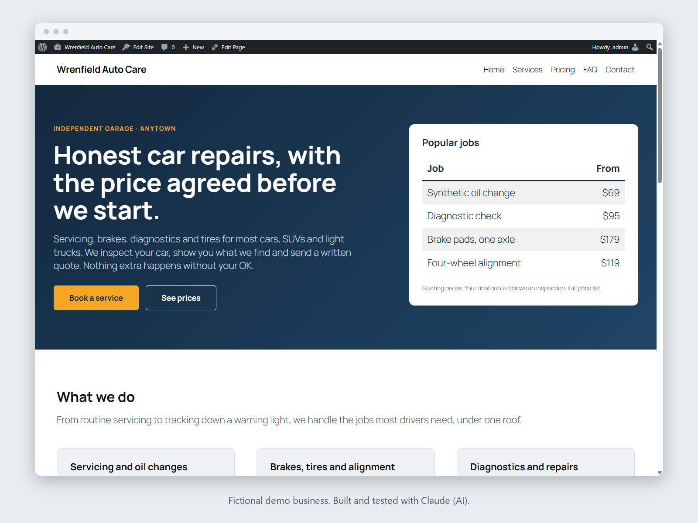

# WordPress site for a small business (sample)

**Live demo:** https://playground.wordpress.net/?blueprint-url=https://raw.githubusercontent.com/jinu041/data-automation-demos/main/wordpress-playground-site/blueprint.json



A five-page website for a made-up auto repair shop, Wrenfield Auto Care, built with WordPress core blocks on the default Twenty Twenty-Five theme, with a Contact Form 7 booking form. The link opens it in WordPress Playground, the official WordPress that runs entirely in the browser: no install, no account. You land on the home page logged in as admin, so the pages, the block editor, the Site Editor and the form settings are one click away.

## Pages

| Page | What it shows |
|---|---|
| Home | Hero with "Book a service" and "See prices" buttons and a starting-price card, three service cards, four "how we work" points, opening hours and address, and a booking call-to-action band |
| Services | Six service cards with starting prices, and the three steps after booking |
| Pricing | A "starting at" table for nine common jobs, a note that final quotes follow inspection, and what is always free |
| FAQ | Seven questions in Details blocks (click to open) |
| Contact | The booking form (name, email, phone, car make and model, preferred date, message), opening hours and a "find us" text block |

The header menu lists the five pages and turns into a menu button on phones. The footer (a template part) has the address, hours and the same menu.

## How it's built

- `blueprint.json` runs 18 readable steps: install Contact Form 7 and Twenty Twenty-Five from wordpress.org, set the title, tagline and permalinks, load the files in `site/`, then short `runPHP` steps that remove the sample content, create the pages with `wp_insert_post`, set Home as the static front page, build the menu, set up the form, and apply the brand styles and the footer.
- Core blocks only: Cover, Group, Columns, Buttons, Table, Details, List, Heading, Paragraph and Shortcode. No images, no custom code in the pages.
- The brand colors (navy, amber, light gray) are in the site's global styles (`site/styles.json`), so Appearance → Editor → Styles changes them everywhere. The same file makes headings bold and buttons amber and rounded, and holds a few lines of CSS for the form.
- Fonts are the theme's own (Manrope), served by the site itself. No external scripts, fonts, maps or tracking: the home page loads 15 files, all from the demo's own address. Avatars are off, so the admin bar makes no Gravatar requests.
- Internal links are written as `{{home_url}}/contact/` in the page files and filled in at install time, because Playground serves each visit under its own address.
- The form shortcode finds the form by title (`[contact-form-7 title="Service booking request"]`), so the page keeps working when the form gets a different ID on another site.
- Twenty Twenty-Five is installed from wordpress.org instead of using the copy Playground bundles. That keeps the look when WordPress changes its default theme (the nightly build already has a new one), and in one fresh test run the bundled copy made WordPress 7 print a notice about a missing `style.min.css`.

## Files

| File | What it is |
|---|---|
| `blueprint.json` | The Playground blueprint the live link runs |
| `site/home.html`, `services.html`, `pricing.html`, `faq.html`, `contact.html` | Block markup of each page |
| `site/footer.html` | The footer template part |
| `site/styles.json` | Global styles: colors, headings, buttons, form CSS |
| `site/booking-form.txt` | The Contact Form 7 form |
| `check.py` | The checks below (Python standard library only) |
| `portfolio/` | [Desktop](portfolio/pf-1-desktop-home.png), [phone](portfolio/pf-2-mobile.png) and [admin + form](portfolio/pf-3-admin-and-form.png) images, 1600 × 1200, from the browser tests |

## What was tested, and how

Tested in Chrome in November 2026 on WordPress 7.1.5, PHP 8.3, Twenty Twenty-Five 1.5 and Contact Form 7 6.2.6, using the preview below (the same steps with the files inlined and `WP_DEBUG` on):

- The five pages and the main admin screens (dashboard, Pages, Contact Form 7, Site Editor, block editor) return 200, show no PHP warnings, notices or deprecation messages, and leave no `debug.log`.
- Every block passes the block editor's own validation: 177 blocks on the five pages plus the footer and the menu, 0 invalid, none passing only through an older block format.
- The header and footer menus link to the five pages and mark the current one, the phone menu opens, every internal link returns 200, and FAQ items open on click.
- Empty submit: all four required fields show "Please fill out this field." and the form shows its error summary. A submit with made-up test details shows the thank-you message, and the email the shop would get appears in Playground's Dev Tools → Email (Playground keeps mail in the browser; nothing is delivered).
- The admin Pages list shows exactly the five pages, with Home as the front page.
- The phone layout was checked at 390 px wide, with the demo embedded in an iframe (Playground allows embedding).
- WordPress nightly (7.3-alpha): the same pages, no PHP messages, all blocks valid, Twenty Twenty-Five still active.

## Check it

```
python check.py             # blueprint parses, steps listed, 5 pages, form shortcode, README link, block markup, PNGs
python check.py --preview   # also writes preview.tmp/index.html, which opens Playground with the local files inlined
```

The check fails if a step loads a file from outside this folder, a page or the form is not created, block comments have bad JSON or do not close, a link points to a page that does not exist, the README link does not match this folder, or a portfolio image is the wrong size or carries metadata. The live link reads the files from GitHub, so it works once this folder is pushed; before that, use the preview.

## Moving it to real hosting

The client does this in their own browser, from the Playground toolbar or the WordPress admin:

- **Export → Download as .zip** in Playground saves the whole site: files, database and edits. Playground's database is SQLite, so the zip can be imported back into Playground or moved with a migration tool that supports SQLite; a usual MySQL host cannot take it as it is.
- **Tools → Export → All content** in WordPress gives one XML file with the five pages, the menu, the global styles, the footer and the form. On the new site, install Twenty Twenty-Five and Contact Form 7, then use Tools → Import → WordPress. Afterwards set the title and tagline (Settings → General), Home as the front page (Settings → Reading) and Post name permalinks, replace the old Playground address in links with a search-and-replace, and set the form's sender address on the real domain (Contact → Contact Forms → Mail).

## Notes

- The business, address, phone number, prices and all text are fictional: the address is on "Sample Road" in "Anytown", the phone is a 555 number and the email uses example.com. There are no reviews or testimonials and no stock photos.
- Built and checked with Claude, an AI agent.
- The demo runs in the visitor's browser. Opening or reloading the demo link builds a fresh copy from `blueprint.json`; edits stay in that browser only (Playground may keep an autosave under Your Playgrounds).
